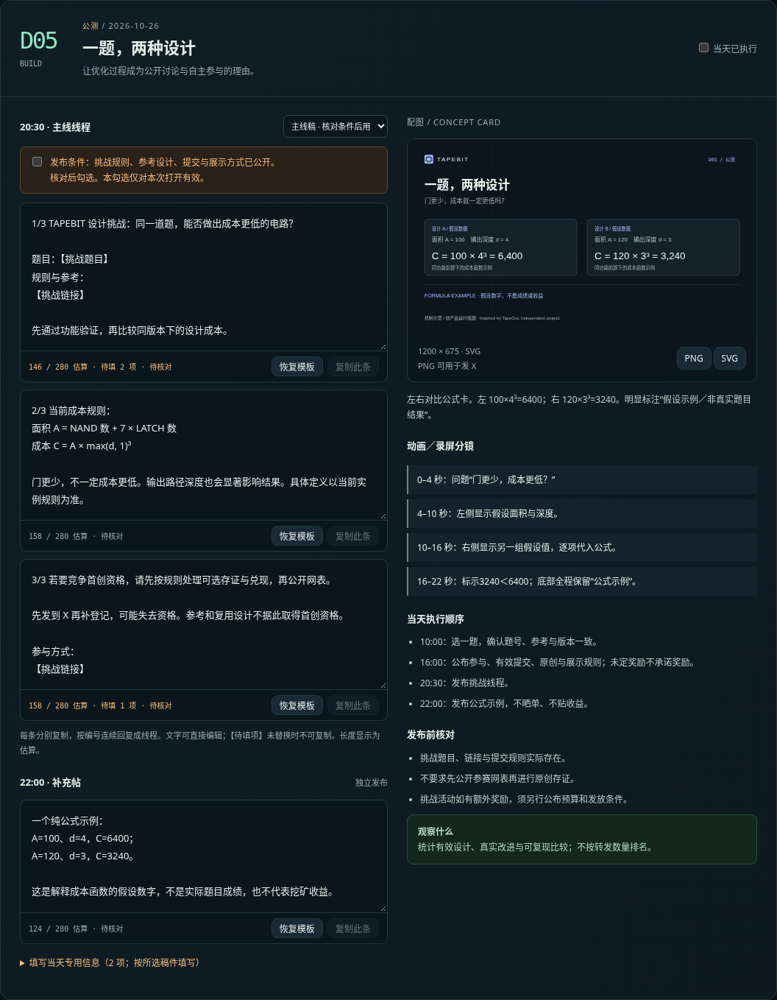

# TAPEBIT · 15 天匿名开发者发推素材

按 D0—D14 编排，包含 62 条主线及晚间文案，以及延期、未就绪、服务异常替代稿。默认 D0 为 2026-10-21，所有排期使用北京时间，可在网页中调整。

## 查看与下载

| 内容 | 入口 |
| --- | --- |
| 在 GitHub 直接阅读全部文案与分镜 | [文案全稿](./文案全稿.md) |
| 下载完整素材包 | [ZIP 下载](./TAPEBIT-15天发推素材包.zip?raw=true) |
| 下载交互时间线网页 | [HTML 下载](./TAPEBIT-15天发推时间线.html?raw=true) |
| 查看 15 张 PNG 配图及 SVG 源文件 | [concept-cards](./concept-cards/) |
| 使用说明 | [使用说明](./使用说明.md) |

下载 HTML 后，用浏览器打开即可，不需要安装依赖或启动服务。GitHub 仓库页面通常展示 HTML 源码；本次提交没有启用 GitHub Pages。

## 网页功能

- 按天查看主线线程、晚间补充、执行步骤、配图及动画/录屏分镜。
- 逐条编辑和复制文案，修改起始日期，填写通用链接与当天数据。
- 选择延期或未就绪稿，导出 TXT、备份/导入 JSON，并打印为 PDF。
- 下载 PNG 和 SVG 图卡；页面没有自动发推功能，不连接钱包。

发布前请替换【待填项】并核对真实状态。条件性公告须满足当天发布条件。主线程按编号逐条回复，不要整段粘贴到同一条推文。字符数为估算，最终以 X 编辑器为准。

## 素材预览

## 内容与验证边界

文案依据项目计划及 TAPEBIT 白皮书 v0.6，未重新验收产品或确认主网部署。D3 公测与 D7 主网是目标窗口。TEST003 原奖励窗口已结束，公测须披露实际实例与奖励安排。

图卡为机制示意，不是产品运行截图。视频提供分镜，实际产品流程需录制真实环境；确认等待经剪辑压缩时应标明。

页面交互已在桌面与手机视口检查，验证摘要见 [verification.json](./verification.json)。`build.py` 可重新生成 HTML、SVG、内容源和 Markdown；PNG 及预览图为已导出的素材。
